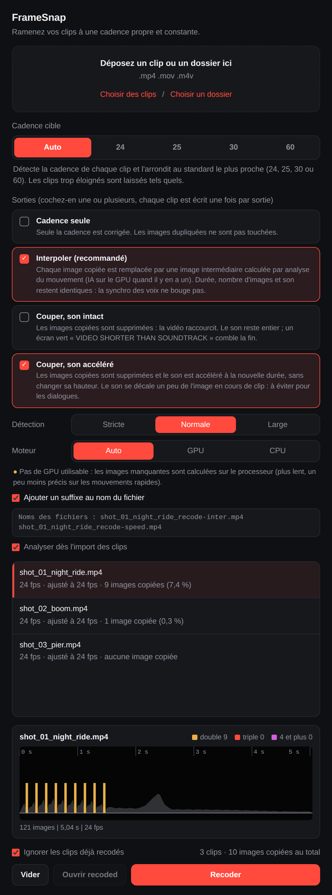
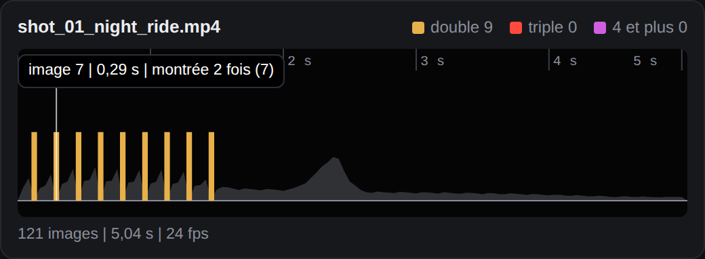
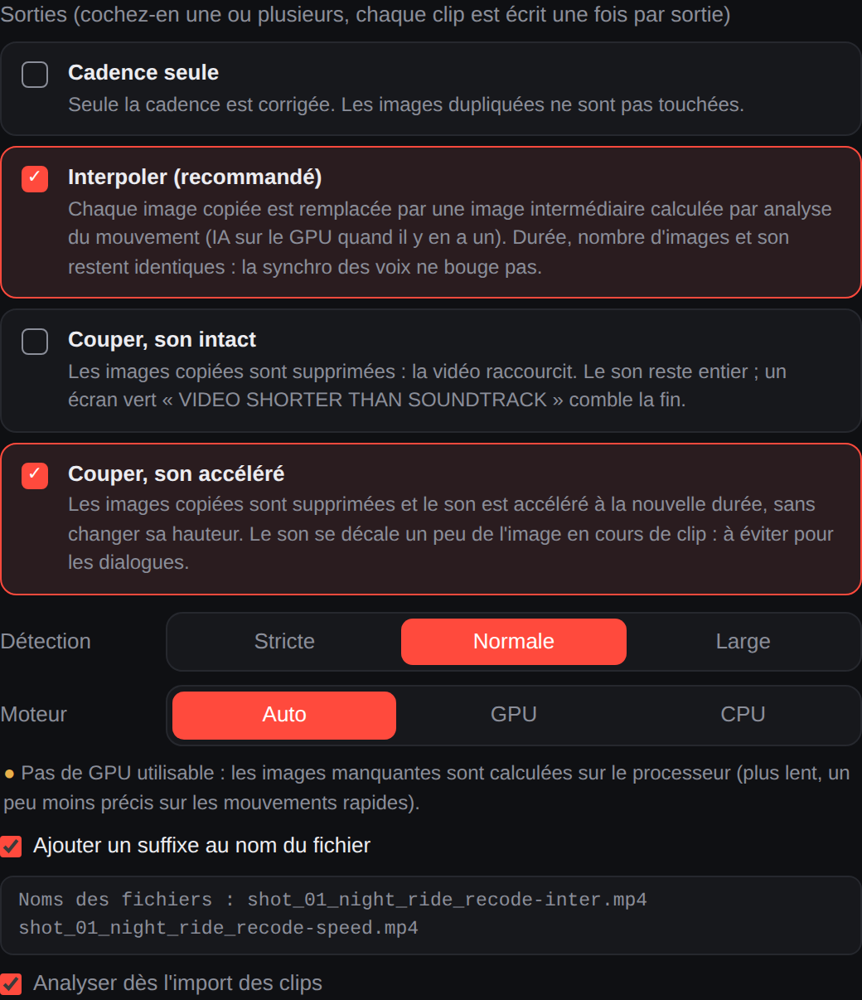
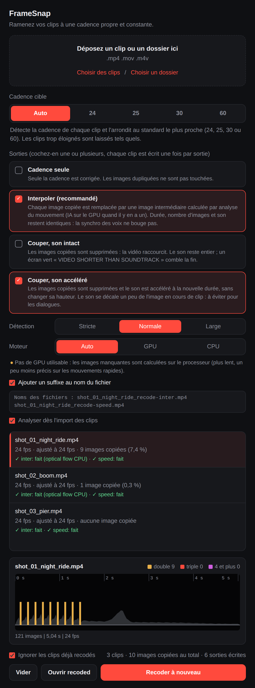
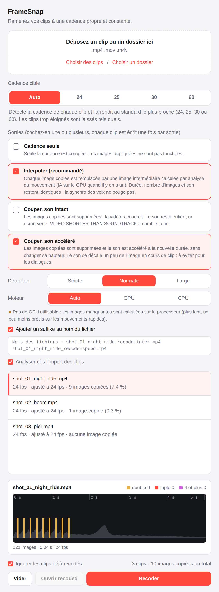

# FrameSnap

Ramenez vos clips vidéo à une cadence **constante et propre : 24, 25, 30 ou 60 fps**.
Déposez un clip ou un dossier, choisissez la cadence cible (ou laissez FrameSnap la
détecter) et récupérez de nouveaux fichiers avec les **mêmes noms** dans un dossier
`recoded`. Nouveau en 2.0 : détection et réparation des **images dupliquées** (saccades),
avec accélération GPU sur Apple Silicon et sur les cartes graphiques Windows.

[English](README.md) | Français

## Captures d'écran



| Timeline des images copiées (survolez un pic) | Les sorties, décrites |
| --- | --- |
|  |  |

| Après un traitement : chaque sortie de chaque clip | Thème clair |
| --- | --- |
|  |  |

Les captures sont dessinées avec la vraie interface et la vraie analyse de trois clips IA (noms de
fichiers changés). Leur ligne GPU indique « Pas de GPU utilisable » car elles ont été générées sur
une machine sans GPU ; sur un Mac Apple Silicon ou un PC Windows avec carte graphique, elle affiche
le périphérique trouvé. `docs/make_state.py` et `docs/shoot.js` les régénèrent.

## Pourquoi

Les outils de vidéo IA (Dreamina, Kling, Seedance...) exportent souvent des clips dont les
images sont en réalité à 24 fps mais dont les timestamps sont posés sur une grille à
60 Hz, ou qui sont à 23,976 ou 29,97 au lieu de 24 ou 30. Premiere Pro et After Effects
lisent alors le clip en **60 fps** (ou une cadence bizarre), ce qui casse les séquences,
crée du saccadé ou ralentit le clip quand on « interprète le métrage ». DaVinci Resolve
n'est pas touché, car il se base sur la cadence moyenne.

FrameSnap mesure la vraie cadence à partir des timestamps des images (et non de l'en-tête
du fichier) et réécrit le clip en cadence parfaitement constante.

## Installation (macOS)

1. Téléchargez le `.dmg` correspondant à votre Mac sur la page [Releases](../../releases) :
   `AppleSilicon` pour les M1 et suivants, `Intel` pour les Mac plus anciens
   (menu Pomme, « À propos de ce Mac »).
2. Ouvrez-le et glissez **FrameSnap** dans **Applications**.
3. Premier lancement : l'app n'est pas notarisée par Apple, macOS demande donc une confirmation.
   * Essayez de l'ouvrir une fois, puis allez dans **Réglages Système, Confidentialité et
     sécurité** et cliquez sur **Ouvrir quand même** (macOS 15 et suivants). Sur un macOS
     plus ancien, clic droit sur l'app puis **Ouvrir**.
   * Ou dans le Terminal : `xattr -dr com.apple.quarantine /Applications/FrameSnap.app`

Rien d'autre à installer : ffmpeg est intégré à l'app.

## Installation (Windows 10 et 11, 64 bits)

1. Sur la page [Releases](../../releases), téléchargez
   * `FrameSnap-x.y.z-Windows-Setup.exe` : un installateur classique (pas besoin des droits
     administrateur), ou
   * `FrameSnap-x.y.z-Windows.zip` : version portable, décompressez-la où vous voulez et
     lancez `FrameSnap.exe`.
2. Premier lancement : l'app n'est pas signée, SmartScreen affiche donc « Windows a protégé
   votre ordinateur ». Cliquez sur **Informations complémentaires**, puis **Exécuter quand même**.

La fenêtre utilise le Microsoft Edge WebView2 Runtime, déjà présent dans Windows 11 et dans
un Windows 10 à jour. Si l'app signale qu'il manque, installez-le depuis
<https://go.microsoft.com/fwlink/p/?LinkId=2124703>. ffmpeg est intégré à l'app.

## Utilisation

1. Déposez un ou plusieurs clips, ou un dossier entier (les sous-dossiers sont parcourus),
   ou utilisez *Choisir des clips* / *Choisir un dossier*.
2. Choisissez la cible :
   * **Auto** : chaque clip est arrondi au standard le plus proche parmi 24, 25, 30, 60.
     Un clip loin de ces valeurs (50 fps par exemple) est laissé tel quel et noté dans le log.
   * **24 / 25 / 30 / 60** : tous les clips sont convertis à cette cadence.
3. Cliquez sur **Recoder**.

Les fichiers vont dans un dossier `recoded` à côté des clips (un dossier déposé garde son
arborescence), avec les mêmes noms : dans Premiere, il suffit de repointer le dossier.
Un `framesnap-log.txt` dans ce dossier note ce qui s'est passé pour chaque fichier.

### Ce qui arrive à chaque clip

| Situation | Action |
| --- | --- |
| Déjà en cadence constante propre à la cible | copié tel quel |
| À moins de 2,5 % de la cible (23,6, 23,976, 24,003, 29,97, 29,4, 59,94...) avec des timestamps réguliers | **retimé** : aucune image ajoutée ni supprimée, l'image N est datée N / cible. L'audio est étiré du petit rapport (0,1 % pour 23,976 vers 24) pour rester synchrone |
| Loin de la cible, ou timestamps irréguliers (vraie cadence variable) | **converti** : images dupliquées ou supprimées selon leurs vrais timestamps, durée conservée |
| Mode Auto et cadence éloignée de 24, 25, 30, 60 | laissé tel quel, noté dans le log |

La sortie est en H.264 (x264, CRF 12, preset slow, 8 bits 4:2:0), AAC 256 kb/s 48 kHz, une
image clé par seconde, avec l'extension d'origine (`.mp4`, `.mov`, `.m4v`). Chaque résultat
est vérifié (cadence constante, nombre d'images) avant de remplacer le fichier temporaire.

## Analyse et timeline

Dès l'import, FrameSnap analyse les clips en arrière-plan (chaque clip est décodé une fois, en
basse résolution) et affiche le résultat dans la liste : « 9 images copiées (7,4 %) ». Cliquez sur
un clip pour voir sa **timeline** : un pic pour chaque image montrée deux fois (ambre), trois fois
(rouge) ou plus (violet), sur la courbe du mouvement. Survolez un pic pour lire le numéro de
l'image, le temps et le nombre de fois où l'image est montrée. Changer le niveau de détection
(Stricte, Normale, Large) met à jour les comptes et la timeline instantanément, sans décoder de
nouveau. L'analyse peut être désactivée (« Analyser dès l'import des clips ») et lancée à la main
avec le bouton Analyser.

## Plusieurs sorties, suffixes, recoder à nouveau

* **Les sorties sont des cases à cocher.** Cochez-en une ou plusieurs : *Cadence seule*,
  *Interpoler*, *Couper, son intact*, *Couper, son accéléré*. Chaque clip est écrit une fois par
  sortie cochée.
* **Suffixe.** « Ajouter un suffixe au nom du fichier » donne `clip_recode.mp4` (cadence seule),
  `clip_recode-inter.mp4`, `clip_recode-keep.mp4` et `clip_recode-speed.mp4`, tous dans le dossier
  `recoded`. Un aperçu des noms s'affiche sous l'option.
* **Sans suffixe**, le nom reste identique (relink facile). Avec plusieurs sorties cochées, chaque
  sortie a alors son propre dossier pour que deux sorties ne s'écrasent jamais :
  `recoded/cadence/`, `recoded/inter/`, `recoded/keep/`, `recoded/speed/`.
* **Recoder à nouveau.** Rien n'est à réimporter : changez la cadence, les sorties, la détection ou
  le suffixe, puis cliquez sur *Recoder à nouveau*. Les résultats sont listés sous chaque clip. Les
  fichiers écrits pendant la session sont refaits ; ceux d'une session précédente sont ignorés tant
  que « Ignorer les clips déjà recodés » est coché.

## Images dupliquées (saccades)

Les générateurs IA gardent parfois une image : elle est répétée, souvent pas à l'identique
au bit près, car le bruit de compression rend la copie très légèrement différente. Cela donne
des saccades ou un effet stop motion. FrameSnap sait trouver ces images et les réparer.

**Détection.** Chaque image est comparée à la précédente, par rapport au mouvement autour
d'elle : les quasi-copies sont attrapées, mais pas les plans fixes ni les panoramiques lents.
Trois niveaux : Stricte, Normale, Large. Chaque clip affiche son compte, par exemple
« 9 images copiées (7,4 %) ».

**Trois modes** (plus « Ne pas toucher ») :

| Mode | Ce qui se passe | Durée | Son | À utiliser pour |
| --- | --- | --- | --- | --- |
| **Interpoler** (recommandé) | Chaque image copiée est remplacée par une nouvelle image intermédiaire calculée à partir de ses vraies voisines | inchangée | intact | les dialogues et tout ce qui doit rester synchro |
| **Couper, son intact** | Les images copiées sont supprimées | plus courte | intact, donc plus long que l'image : un écran vert « VIDEO SHORTER THAN SOUNDTRACK » comble la fin | quand vous couperez la fin vous-même |
| **Couper, son accéléré** | Les images copiées sont supprimées | plus courte | accéléré à la nouvelle durée sans changer sa hauteur | ambiances ou musique ; le son se décale de l'image en cours de clip (environ un quart de seconde si les coupes sont groupées au début), donc à éviter pour les dialogues |

**Moteur pour les images manquantes** (mode Interpoler) :

| Machine | Moteur |
| --- | --- |
| Mac avec puce Apple Silicon | RIFE (IA) sur le GPU Apple, via Metal |
| Windows avec carte NVIDIA, AMD ou Intel | RIFE (IA) sur la carte graphique, via son pilote Vulkan. Le kit CUDA n'est pas nécessaire |
| Aucun GPU utilisable (machine virtuelle, bureau à distance, pilote ancien) | Optical flow sur le processeur (OpenCV DIS), plus lent et un peu moins précis sur les mouvements rapides |

« Auto » choisit le GPU quand un vrai GPU fonctionne, et n'utilise jamais un Vulkan émulé
(beaucoup trop lent). La fenêtre indique le moteur trouvé, chaque clip indique celui qui a
servi, et `python -m framesnap.cli --gpu-check` le teste depuis un terminal. Sur des images
cachées puis reconstruites à partir d'un vrai rush (PSNR) : répéter l'image précédente
26,6 dB, optical flow CPU 34,7 dB, RIFE 35,4 dB, RIFE étant devant de 2 à 4 dB sur les
mouvements rapides.

**Limites.** L'interpolation peut laisser des artefacts sur un mouvement très rapide ou quand
un objet apparaît de derrière un autre. Une image copiée à côté d'une coupe de plan est
laissée telle quelle, et les images copiées tout à la fin d'un clip ne peuvent pas être
interpolées. Un arrêt sur image volontaire compte comme une image copiée : choisissez le mode
lot par lot.

## Ligne de commande

Le même moteur, sans fenêtre :

```
python -m framesnap.cli CLIPS_OU_DOSSIERS... [--fps auto|24|25|30|60] [--dry-run] [--overwrite]
    [--repair off|interpolate|cut-keep|cut-stretch ...] [--suffix]
    [--sensitivity strict|normal|loose] [--engine auto|gpu|cpu]
python -m framesnap.cli --gpu-check
```

`--repair` peut être répété ou séparé par des virgules pour écrire plusieurs sorties
(`--repair interpolate,cut-stretch`) ; `--suffix` les nomme `_recode-inter`, `_recode-speed`...
au lieu d'utiliser un dossier par sortie. `--dry-run` affiche seulement ce qui serait fait pour
chaque clip, avec son nombre d'images copiées quand `--repair` est indiqué.

## Lancer depuis les sources

```
pip install -r requirements.txt
python packaging/fetch_rife.py   # facultatif : télécharge RIFE pour l'interpolation GPU (environ 20 Mo)
python -m framesnap            # ouvre l'app (sous Windows : py -m framesnap)
python -m pytest               # tests du moteur et du contrôleur (vrai ffmpeg)
cd tests/ui && npm install && npm test   # tests de l'interface (jsdom)
```

Python 3.9 ou plus. ffmpeg vient du paquet `imageio-ffmpeg` ; définissez
`FRAMESNAP_FFMPEG=/chemin/vers/ffmpeg` pour utiliser le vôtre.

## Construire les apps

Les releases sont construites par GitHub Actions : macOS (Apple Silicon et Intel) et Windows (64 bits).

* Poussez un tag : `git tag v1.1.0 && git push origin v1.1.0`. Le workflow
  *Release builds* lance les tests, construit chaque app, exécute un auto-test de l'app
  packagée (elle encode un clip synthétique avec le ffmpeg intégré) et attache les fichiers à
  la Release GitHub : deux `.dmg`, un installateur Windows et un zip Windows.
* Ou lancez-le à la main depuis l'onglet Actions (*Run workflow*) : les fichiers sont
  disponibles comme artefacts de l'exécution.
* En local sur un Mac : `pip install -r requirements-dev.txt && bash packaging/build_macos.sh`.
* En local sur Windows : `pip install -r requirements-dev.txt` puis
  `powershell -ExecutionPolicy Bypass -File packaging\build_windows.ps1`
  (l'étape installateur demande [Inno Setup 6](https://jrsoftware.org/isinfo.php)).

## Licence

GPL-3.0 ou ultérieure (voir `LICENSE`, et `THIRD_PARTY_NOTICES.md` pour les composants intégrés). Le ffmpeg intégré est une build statique GPL
incluant x264, fournie par le paquet [imageio-ffmpeg](https://github.com/imageio/imageio-ffmpeg).
La fenêtre est réalisée avec [pywebview](https://pywebview.flowrl.com).
