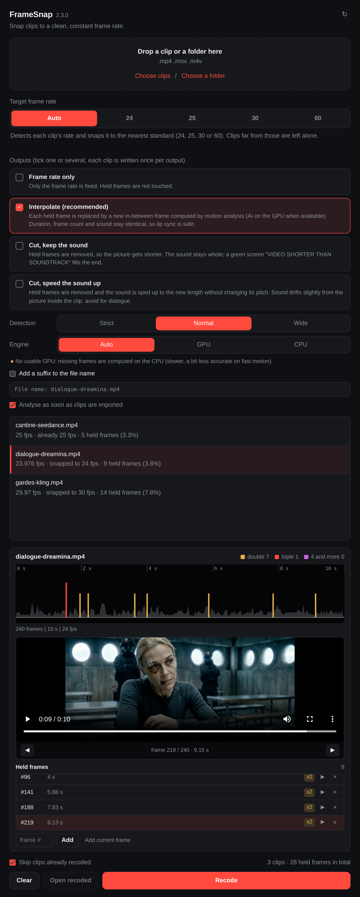
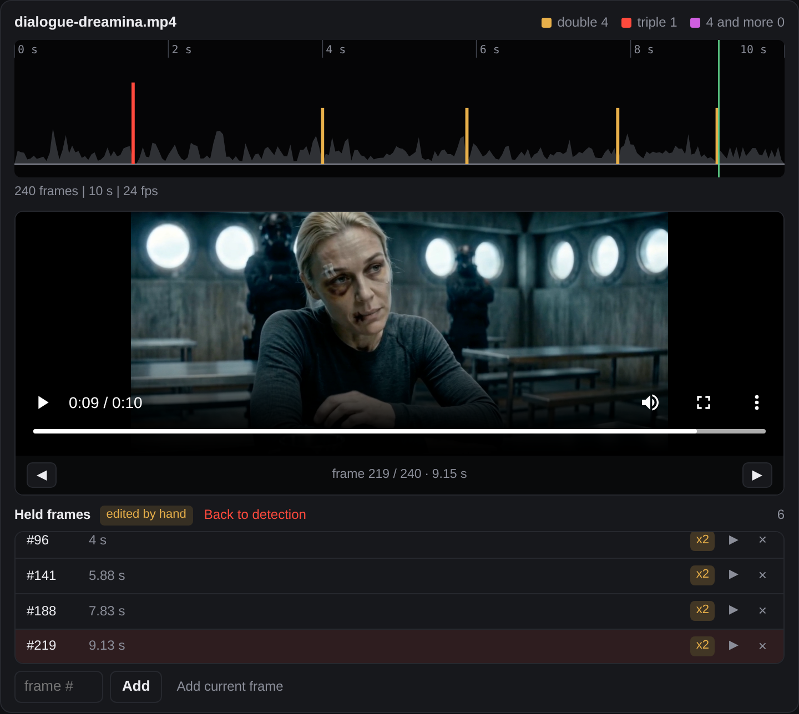
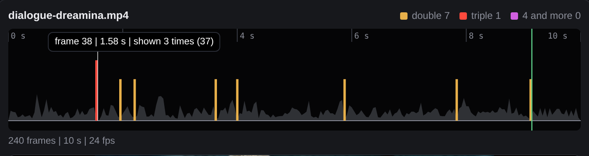
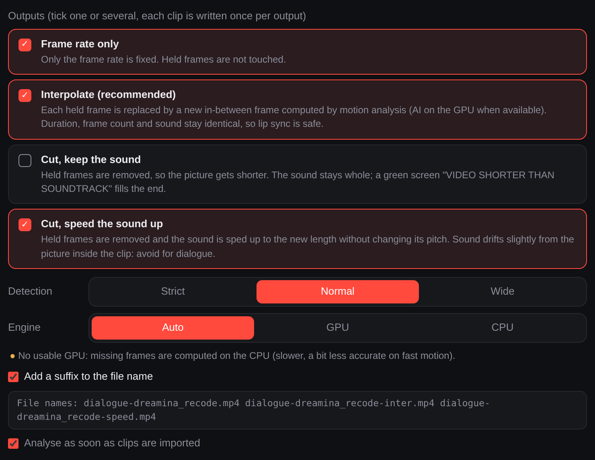
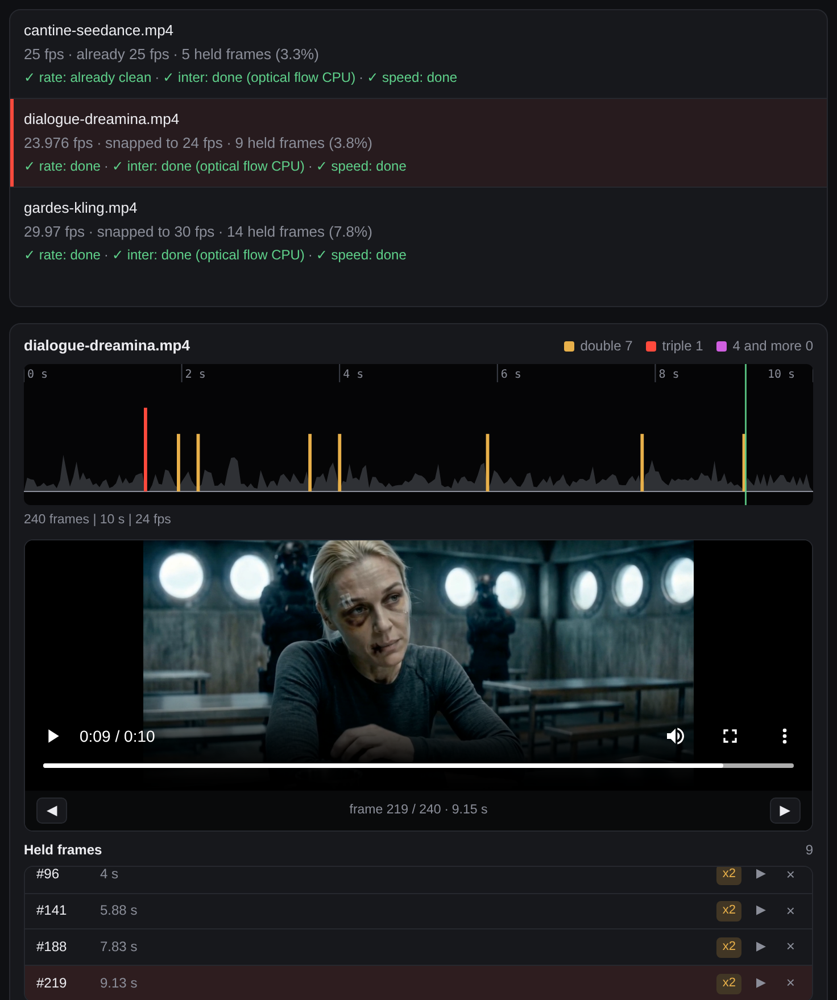
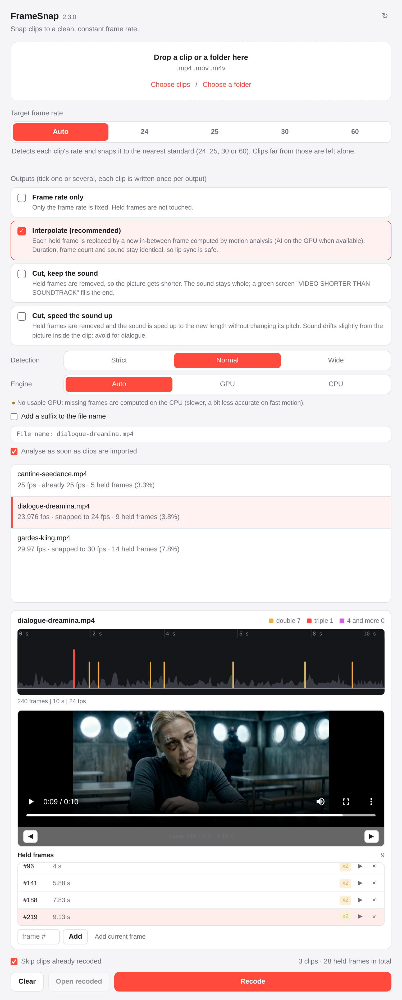

# FrameSnap

Snap video clips to a clean, constant **24, 25, 30 or 60 fps**. Drop a clip or a
folder, pick a target rate (or let FrameSnap detect it), and get new files with
the **same names** in a `recoded` folder. New in 2.0: detect and repair **duplicated
frames** (stutter), with GPU acceleration on Apple Silicon and on Windows graphics cards.
New in 2.3: video preview with frame by frame stepping and manual correction of the held
frames, exact colours in repaired outputs, and a long list of robustness fixes (see
[CHANGELOG.md](CHANGELOG.md)).

English | [Français](README.fr.md)

## Screenshots



### Video preview and manual corrections



The selected clip plays under its timeline, with its sound. The arrows step one frame back or
forward, the frame number and time show between them, and the green cursor follows playback on
the timeline. Here the preview is stopped on frame 219, a held frame, highlighted in the list.
Three false detections (frames 47, 53 and 87) were removed with the cross, hence the "edited by
hand" badge; "Back to detection" brings them back.

| Held frames timeline (hover a spike) | Outputs, described |
| --- | --- |
|  |  |

| After a run: every output of every clip | Light theme |
| --- | --- |
|  |  |

The screenshots are drawn from the real 2.3 interface, with the real analysis, processing and
preview server. The three demo clips are made from one frame of the dialogue-dreamina rush
(slight camera move, a few held frames added). Their GPU line says "No usable GPU" because they
were generated on a machine without one; on a Mac with Apple Silicon or a Windows PC with a
graphics card it shows the device found. `python docs/make_screenshots.py IMAGE` regenerates
them (needs Playwright).

## Why

AI video tools (Dreamina, Kling, Seedance...) often export clips whose frames are
really 24 fps but whose timestamps sit on a 60 Hz grid, or that are 23.976 or 29.97
instead of 24 or 30. Premiere Pro and After Effects then read the clip as **60 fps**
(or an odd rate), which breaks sequences, adds judder or slows the clip down
when you "interpret footage". DaVinci Resolve is not affected, because it looks at
the average rate.

FrameSnap measures the real frame rate from the frame timestamps (not from the file
header) and rewrites the clip as a perfectly constant frame rate file.

## Install (macOS)

1. Download the `.dmg` for your Mac from the [Releases](../../releases) page:
   `AppleSilicon` for M1 and newer, `Intel` for older Macs
   (Apple menu, About This Mac, tells you which one you have).
2. Open it and drag **FrameSnap** to **Applications**.
3. First launch: the app is not notarized by Apple, so macOS asks for confirmation.
   * Try to open it once, then go to **System Settings, Privacy & Security** and click
     **Open Anyway** (macOS 15 and later). On older macOS, right click the app and choose **Open**.
   * Or in Terminal: `xattr -dr com.apple.quarantine /Applications/FrameSnap.app`

Nothing else to install: ffmpeg is built into the app.

## Install (Windows 10 and 11, 64 bit)

1. From the [Releases](../../releases) page, download either
   * `FrameSnap-x.y.z-Windows-Setup.exe`: a normal installer (no admin rights needed), or
   * `FrameSnap-x.y.z-Windows.zip`: portable, unzip it anywhere and run `FrameSnap.exe`.
2. First launch: the app is not code signed, so SmartScreen shows "Windows protected
   your PC". Click **More info**, then **Run anyway**.

The window needs the Microsoft Edge WebView2 Runtime, which is already part of Windows 11
and of up to date Windows 10. If the app tells you it is missing, install it from
<https://go.microsoft.com/fwlink/p/?LinkId=2124703>. ffmpeg is built into the app.

## Use

1. Drop one or several clips, or a whole folder (sub folders are scanned), or use
   *Choose clips* / *Choose a folder*.
2. Pick the target:
   * **Auto**: each clip is snapped to the nearest of 24, 25, 30, 60. Clips that are
     not close to any of them (for example 50 fps) are left alone and listed in the log.
   * **24 / 25 / 30 / 60**: every clip is converted to that rate.
3. Press **Recode**.

Output goes to a `recoded` folder next to the clips (a folder drop keeps its
structure), with the same file names, so in Premiere you only need to relink the
folder. A `framesnap-log.txt` in that folder records what happened to each file.

### What happens to each clip

| Situation | Action |
| --- | --- |
| Already a clean constant rate at the target | copied untouched |
| Within 2.5 percent of the target (23.6, 23.976, 24.003, 29.97, 29.4, 59.94...) and regular timestamps | **retimed**: no frame added or dropped, frame N is stamped N / target. Audio is stretched by the tiny ratio (0.1 percent for 23.976 to 24) to stay in sync |
| Far from the target, or irregular timestamps (true variable frame rate) | **converted**: frames duplicated or dropped following their real timestamps, duration preserved |
| Auto mode and not close to 24, 25, 30 or 60 | left alone, written in the log |

Output is H.264 (x264, CRF 12, slow preset, 8 bit 4:2:0), AAC 256 kbps 48 kHz,
one keyframe per second, `.mp4`/`.mov`/`.m4v` kept as in the source. Each result is
verified (constant rate, frame count) before it replaces the temporary file.

## Analysis and timeline

As soon as clips are imported, FrameSnap analyses them in the background (it decodes each
clip once at low resolution) and shows the result in the list: "9 held frames (7.4 %)".
Click a clip to see its **timeline**: one spike for every picture that is shown twice (amber),
three times (red) or more (violet), over the curve of the motion. Hover a spike to read the
frame number, the time and how many times the picture is shown. Changing the detection level
(Strict, Normal, Wide) updates the counts and the timeline instantly, without decoding again.
The analysis can be switched off ("Analyse as soon as clips are imported"), and started by
hand with the Analyse button.

## Several outputs, suffixes, recode again

* **Outputs are checkboxes.** Tick one or several: *Frame rate only*, *Interpolate*, *Cut, keep
  the sound*, *Cut, speed the sound up*. Each clip is written once per ticked output.
* **Suffix.** "Add a suffix to the file name" gives `clip_recode.mp4` (frame rate only),
  `clip_recode-inter.mp4`, `clip_recode-keep.mp4` and `clip_recode-speed.mp4`; all in the
  `recoded` folder. A preview of the names is shown under the option.
* **Without suffix** the name stays the same (easy relink). With several outputs ticked, each
  output then gets its own folder so that two outputs never overwrite each other:
  `recoded/cadence/`, `recoded/inter/`, `recoded/keep/`, `recoded/speed/`.
* **Recode again.** Nothing has to be imported twice: change the rate, the outputs, the
  detection or the suffix, then press *Recode again*. Results are listed under each clip.
  Files written during the session are redone. A file that was already there from an earlier
  session is skipped while "Skip clips already recoded" is ticked, but only if it was made with
  the same settings (rate, output, detection or hand edited held frames, quality): otherwise it
  is redone. FrameSnap remembers the settings of each output in a small hidden file,
  `recoded/.framesnap-manifest.json`. Files made by versions before 2.3 have no such record and
  are kept.

## Duplicated frames (stutter)

AI generators sometimes hold a frame: the picture is repeated, often not bit for bit
because compression noise makes the copy differ very slightly. It reads as stutter or
stop motion. FrameSnap can find these frames and repair them.

**Detection.** Each frame is compared with the previous one, relative to the motion around
it, so near copies are caught while still shots and slow pans are not. Three levels:
Strict, Normal, Wide. Each clip shows its count, for example "9 held frames (7.4 %)".

**Three modes** (plus "Leave as is"):

| Mode | What happens | Duration | Sound | Use it for |
| --- | --- | --- | --- | --- |
| **Interpolate** (recommended) | Each held frame is replaced by a new in-between frame computed from its real neighbours | unchanged | untouched | dialogue and anything that must stay in sync |
| **Cut, keep the sound** | Held frames are removed | shorter | untouched, so it outlasts the picture: a green screen "VIDEO SHORTER THAN SOUNDTRACK" fills the end | when you will trim the end yourself |
| **Cut, speed the sound up** | Held frames are removed | shorter | sped up to the new length without changing its pitch | ambience or music; the sound drifts from the picture inside the clip (about a quarter of a second when the cuts are bunched at the start), so avoid it for dialogue |

**Engine for the missing frames** (Interpolate mode):

| Machine | Engine |
| --- | --- |
| Mac with Apple Silicon | RIFE (AI) on the Apple GPU, through Metal |
| Windows with NVIDIA, AMD or Intel graphics | RIFE (AI) on the graphics card, through its Vulkan driver. The CUDA toolkit is not needed |
| No usable GPU (virtual machine, remote desktop, old driver) | Optical flow on the CPU (OpenCV DIS), slower and a little less accurate on fast motion |

"Auto" picks the GPU when a real one works, and never uses emulated Vulkan (far too slow).
The window says which engine was found, each clip says which one was used, and
`python -m framesnap.cli --gpu-check` tests it from a terminal. On frames hidden then rebuilt
from a real rush (PSNR): repeating the previous frame 26.6 dB, CPU optical flow 34.7 dB,
RIFE 35.4 dB, RIFE being ahead by 2 to 4 dB on fast motion.

**Colours.** The frames that are kept go from the decoder to the encoder untouched (8 bit YUV
4:2:0), only the computed frames go through RGB, and the colour tags of the source (range,
matrix, primaries, transfer) are written to the output. Versions 2.0 to 2.2 converted every
frame to RGB and back, which made the repaired outputs about 2 to 3 levels darker and slightly
tinted: redo those outputs with 2.3. Phone clips recorded in portrait (rotation metadata) are
handled too.

**Preview and manual corrections.** Under the timeline, the selected clip plays with its sound.
The buttons next to the frame number step one frame at a time; clicking the timeline jumps to
that frame. The list of held frames can be edited: remove a false detection with the cross, add
a frame by its number or with "Add current frame". Hand edits are kept when the detection level
changes or the clip is analysed again; "Back to detection" drops them. Changing the target rate
drops them as well, since the frame numbers change.

**Limits.** Interpolation can leave artefacts on very fast motion or when an object appears
from behind another. A held frame next to a scene cut is left alone, and held frames at the
very end of a clip cannot be interpolated. Deliberate freeze frames count as held frames, so
choose the mode per batch.

## Command line

The same engine without a window:

```
python -m framesnap.cli CLIPS_OR_FOLDERS... [--fps auto|24|25|30|60] [--dry-run] [--overwrite]
    [--repair off|interpolate|cut-keep|cut-stretch ...] [--suffix]
    [--sensitivity strict|normal|loose] [--engine auto|gpu|cpu]
python -m framesnap.cli --gpu-check
```

`--repair` can be repeated or comma separated to write several outputs
(`--repair interpolate,cut-stretch`); `--suffix` names them `_recode-inter`, `_recode-speed`...
instead of using one folder per output. `--dry-run` only prints what would be done for each
clip, including its number of held frames when `--repair` is set.

## Run from source

```
pip install -r requirements.txt
python packaging/fetch_rife.py   # optional: RIFE for GPU interpolation (downloads about 430 MB once, keeps about 40 MB)
python -m framesnap            # opens the app (on Windows: py -m framesnap)
python -m pytest               # engine, colour, preview server and controller tests (real ffmpeg)
cd tests/ui && npm install && npm test   # interface tests (jsdom)
```

Python 3.9 or newer. ffmpeg is taken from the `imageio-ffmpeg` package; set
`FRAMESNAP_FFMPEG=/path/to/ffmpeg` to use your own.

## Build the apps

Releases are built by GitHub Actions: macOS (Apple Silicon and Intel) and Windows (64 bit).

* Push a tag: `git tag v2.3.0 && git push origin v2.3.0`. The workflow
  *Release builds* runs the tests, builds each app, runs a self test of the packaged app
  (it encodes and repairs a synthetic clip with the bundled ffmpeg and checks the preview
  server), and attaches the files to the GitHub Release: two `.dmg`, one Windows installer and
  one Windows zip. The Release is only published when every platform succeeded.
* Or run it by hand from the Actions tab (*Run workflow*): the files are attached to the
  run as artifacts.
* Locally on a Mac: `pip install -r requirements-dev.txt && bash packaging/build_macos.sh`.
* Locally on Windows: `pip install -r requirements-dev.txt` then
  `powershell -ExecutionPolicy Bypass -File packaging\build_windows.ps1`
  (the installer step needs [Inno Setup 6](https://jrsoftware.org/isinfo.php)).

## Privacy

FrameSnap works offline. Its only internet request is one check of the latest version on
GitHub (`api.github.com/repos/le-wib/framesnap/releases/latest`) when the window opens, and
again when you press the refresh button next to the name. Nothing about your clips is sent.
To switch it off, set the environment variable `FRAMESNAP_NO_UPDATE_CHECK=1`.

The preview is streamed by a small server inside the app that listens on `127.0.0.1` only,
on a random port, behind a random secret address that changes for every clip and stops working
when the clip is removed, the list is cleared or the app is closed.

## License

GPL-3.0-or-later (see `LICENSE`, and `THIRD_PARTY_NOTICES.md` for the bundled components). The bundled ffmpeg is a static GPL build that
includes x264, provided by the [imageio-ffmpeg](https://github.com/imageio/imageio-ffmpeg)
package; FFmpeg is a trademark of Fabrice Bellard, see [ffmpeg.org](https://ffmpeg.org).
The window is made with [pywebview](https://pywebview.flowrl.com).
